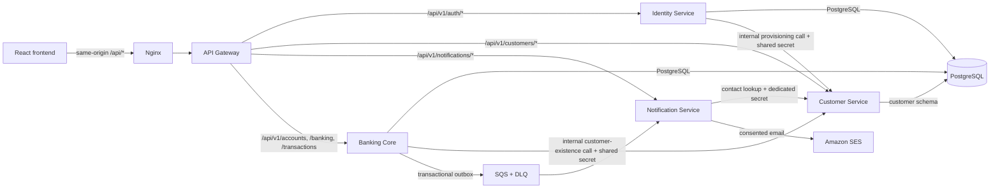
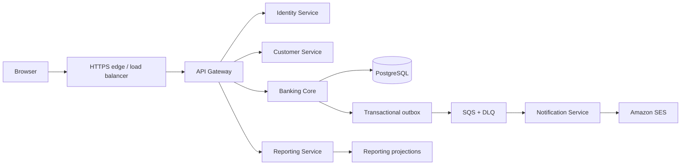

# Architecture: Event-Sourced Ledger / NexusBank

This document describes both the checked-in application and the proposed end
state. The sections are deliberately labeled so future work does not mistake
planned components for implemented ones.

## Project identity

- **Repository/project name:** Event-Sourced Ledger.
- **Product/UI name:** NexusBank has been used in planning and some service
  descriptions; whether it becomes the permanent product name is still open.
- Until that decision is made, preserve existing names and avoid broad
  rebranding.

## Current system

The project is a React banking application backed by a TypeScript/Express
banking API and PostgreSQL. There are also separate Identity Service and API
Gateway Node applications, plus separate Customer and Notification Services.
The banking domain remains a modular monolith: accounts, banking operations,
transactions, ledger, outbox, and idempotency share one process and database
transaction boundary.

### Runtime and repository layout

| Component | Location | Responsibility |
|---|---|---|
| React frontend | `frontend/` | Authentication UI, dashboard, accounts, deposits, withdrawals, transfers, and transaction views. |
| Banking backend | `src/` | Express API and modular banking domain: accounts, ledger entries, transactions, and idempotency. It checks customer existence through Customer Service and retains relational foreign keys. |
| Identity Service | `services/identity-service/` | Sole registration/login authority; owns credential reads/writes in the `identity` schema and provisions profiles through Customer Service's protected API. |
| Customer Service | `services/customer-service/` | Authoritative profile create/read/update API; owns application reads and writes to `customer.customers`. |
| Notification Service | `services/notification-service/` | Owns opt-in preferences, consent history, event processing, delivery attempts, and consent-aware email notifications. |
| API Gateway | `services/api-gateway/` | Routes auth to Identity, profiles to Customer, notification preferences to Notification, and banking requests to Banking. Denies internal service routes. |
| PostgreSQL migrations | `migrations/` | Schema migrations for customer profiles, bank accounts, ledger accounts, transactions, ledger entries, idempotency keys, Identity credentials, transactional outbox, and notifications. |
| Docker | `Dockerfile`, `docker-compose.yml`, `docker/`, and service directories | Local multi-container deployment with PostgreSQL 17, five Node services, and nginx frontend. |

### Current request and data flow

1. The browser sends `/api/*` requests to nginx, which proxies them to the
   API Gateway.
2. The Gateway routes `/api/v1/auth/*` to Identity,
   `/api/v1/customers/*` to Customer Service,
   `/api/v1/notifications/*` to Notification Service, and only the documented
   `/api/v1/accounts`, `/api/v1/banking`, and `/api/v1/transactions` resources
   to Banking. Other `/api/v1/*` paths are not forwarded.
3. During registration, Identity calls Customer Service's protected create
   endpoint using `CUSTOMER_PROVISIONING_SECRET`, then stores the returned
   customer ID, login email, and password hash in `identity.credentials`.
4. Customer Service authenticates profile reads and updates with the shared
   JWT contract and enforces customer ownership. Banking validates a customer
   through Customer Service before account creation; PostgreSQL foreign keys
   remain a final integrity guard.
5. Banking writes notification events to the transactional outbox in the same
   transaction as financial changes. The outbox publisher sends committed
   events to SQS; Notification Service validates and deduplicates them, checks
   consent, fetches contact details from Customer Service, and sends via SES.
   Notification failures cannot roll back a banking transaction. See
   [notifications.md](./notifications.md) for consent, retry, and replay
   behavior.
6. In Compose, Banking applies migrations and initial seed. Customer Service's
   readiness check waits for the migrated customer schema; Identity and
   Notification wait for their dependencies' health checks, and Gateway waits
   for all routed services.

### Database and ledger facts

The checked-in migrations create:

| Table | Purpose |
|---|---|
| `customer.customers` | Customer Service-owned profiles. |
| `identity.credentials` | Identity-owned login email, customer ID, and password hash. |
| `notification.preferences` and `notification.preference_history` | Notification-owned email preferences and consent/revocation history. |
| `notification.events`, `notification.deliveries`, and `notification.delivery_attempts` | Event deduplication, per-recipient delivery state, and attempt history. |
| `banking_outbox` | Banking-owned transactional event outbox published asynchronously to SQS. |
| `legacy_users` | Preserved pre-extraction credential rows; no application code reads or writes this compatibility table. |
| `bank_accounts` | Customer-owned bank accounts. |
| `ledger_accounts` | System and customer accounting accounts. |
| `transactions` | Financial transaction records. |
| `ledger_entries` | Debit/credit entries associated with transactions and ledger accounts. |
| `idempotency_keys` | Request hash, status, response, and expiry for idempotent writes. |

The banking logic writes ledger entries and transaction data inside database
transactions. Account balance queries aggregate debit/credit ledger entries.
Idempotency and account locking protect financial writes against duplicate and
concurrent requests.

**Terminology note:** the product is named Event-Sourced Ledger, and the ledger
is append-oriented and auditable. The current schema does not contain a
`ledger_events` table or a general-purpose domain-event store. Do not describe
the implementation as a fully generalized event-sourcing platform unless that
capability is implemented and verified. Do not add a mutable balance as a
replacement for ledger-derived balances without an explicit design and
consistency strategy.

### Local Docker topology

`docker compose up --build -d` starts:

- `postgres`: PostgreSQL 17 with named volume `ledger-postgres-data`.
- `banking-backend`: applies migrations and safe initial seeding before startup.
- `customer-service`: owns customer profile API and reads/writes.
- `identity-service`: authentication and customer-provisioning client.
- `notification-service`: preference API and opt-in SQS/SES worker.
- `api-gateway`: internal routing service.
- `frontend`: nginx serving the production React build and proxying `/api/`.

Customer Service is not published to the host. The Gateway is the public API
entry point; database and service ports used for local debugging are bound or
restricted as specified in Compose. Secrets are supplied at runtime and are
not baked into images.
See the root `README.md` Docker section for commands and required variables.

## Target architecture (proposed, incremental)

The target is a service-oriented system, not a rewrite. Preserve the existing
ledger and extract boundaries only when the integration tests and data
migration plan support doing so.

### Proposed service boundaries

| Service | Owns (target) | Current state |
|---|---|---|
| Identity | Credentials, sessions, MFA and verification data. | A separate registration/login service exists; it and the banking backend currently share PostgreSQL. |
| Customer | Customer profile and contact data. | A separate Customer Service owns the profile API and `customer.customers` schema; it still shares PostgreSQL and database credentials with other services. |
| Banking Core | Accounts, transactions, ledger entries, idempotency, and atomic financial operations. | Implemented together in the Banking backend process, behind the Gateway's allow-listed `/api/v1` contract. Keep these modules and writes in the same transaction boundary. |
| Notification | Notification preferences, delivery history, and retry state. | Implemented as a separate consent-aware consumer with idempotent delivery tracking; live AWS SQS/SES deployment remains for Phase 11. |
| Reporting | Read models, statements, and reporting metadata. | Not implemented as a separate service. |
| API Gateway | Public API routing and cross-cutting edge controls. | Implemented as a separate service; routes auth, customer profile, notification preferences, and banking API paths. |

### Financial consistency boundary

Accounts, ledger, and transaction writes must remain within one PostgreSQL
transaction boundary. A transfer must not expose a state where only its debit
or credit has committed. If the banking components are later separated
physically, keep them in the same Banking Core service unless an explicit
distributed consistency design is approved.

The proposed outbox is written in the same transaction as the financial
records. A publisher can then deliver committed events asynchronously. Queue
delivery is at least once: consumers must be idempotent, event payloads must be
versioned, and retry/DLQ handling must be observable. None of the outbox, SQS,
notification, or SES pieces exist in the current repository.

### Data ownership and migration direction

Identity, Customer, and Banking still use the same PostgreSQL instance and
deployment credentials. The `identity` and `customer` schemas are logical
ownership boundaries, not yet database-role or network-isolation boundaries.
The customer-table migration moves the existing table into `customer` without
rewriting profile IDs; PostgreSQL retains foreign-key references from Banking
and `legacy_users`. `legacy_users` preserves the old
rows for rollback; the migration backfills Identity credentials without
changing customer IDs or password hashes. Rollback restores Identity-created
credentials to `users` before removing the new schema, and refuses to proceed
if a credential no longer has a matching customer.

Registration spans customer provisioning and credential persistence in two
services. These operations cannot be one PostgreSQL transaction: a failure
while saving a credential after customer creation can leave a customer without
credentials and requires reconciliation. A future provisioning saga or
compensation contract is still needed to automate that recovery.

Before granting per-service database ownership:

1. Inventory all reads/writes and foreign keys across the existing tables.
2. Define the authoritative owner for each table and the APIs/events needed by
   other services.
3. Preserve customer/user IDs and existing ledger history during migration.
4. Plan and test backfill, cutover, rollback, and reconciliation on a copy of
   representative data.
5. Remove cross-service direct database access only after the new owner is
   authoritative.

Prefer separate database roles and schemas as a gradual boundary; separate
database instances are a later operational decision, not a prerequisite for
extracting service processes.

## Proposed AWS deployment

The planning target is S3 + CloudFront for static frontend delivery; ECS
Fargate and ECR for containers; an Application Load Balancer for API routing;
RDS PostgreSQL; SQS with a DLQ; SES; Secrets Manager; CloudWatch; and Route 53
+ ACM for DNS/TLS. Backend services and databases should use private subnets
where appropriate.

This is a proposal, not deployed infrastructure. Validate cost, networking,
data residency, backup/restore, IAM, secrets, and operational requirements
before provisioning AWS resources. ECS Fargate and SQS are preferred starting
options because they reduce operational overhead, but are not irreversible
decisions.

## Architecture guardrails

1. Preserve and test ledger invariants before changing financial paths.
2. Keep account, ledger, and transaction writes atomic.
3. Retain request idempotency and ownership checks through API migrations.
4. Do not route internal provisioning endpoints through public API paths.
5. Do not hardcode secrets, credentials, or environment-specific URLs.
6. Make service extraction incremental, observable, and reversible where
   practical.
7. Treat diagrams and target components as proposals until their phase is
   implemented and verified.

## Decisions still open

- Permanent project/product name: Event-Sourced Ledger, NexusBank, or both
  (repository versus product).
- Whether the long-term service database boundary is per-schema, per-database,
  or per-instance.
- Production deployment region, environments, cost limits, and data-retention
  requirements.
- Identity capabilities and session/token revocation requirements.
- Notification event catalog, delivery policy, and customer consent model.
- Reporting consistency and statement-generation requirements.

See [execution-plan.md](./execution-plan.md) for phase ordering, status, and
acceptance criteria.
