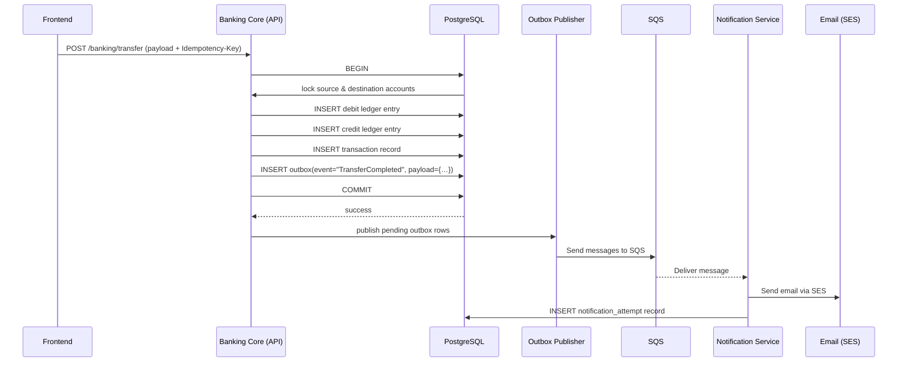
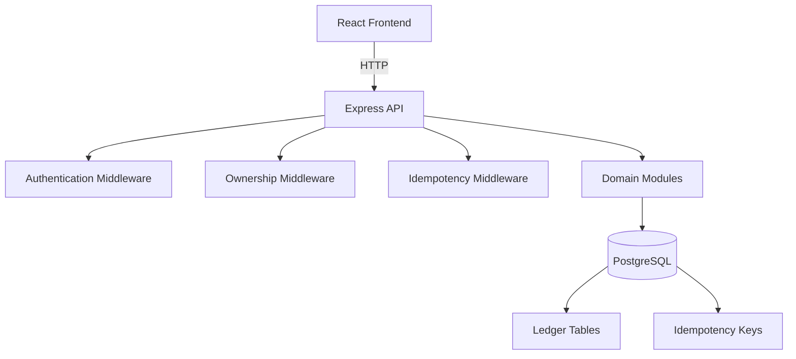
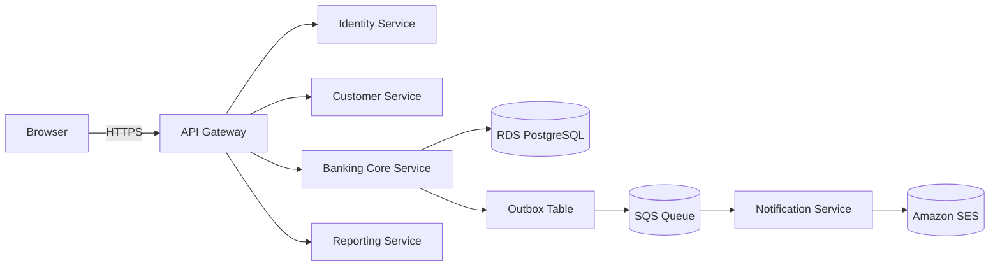
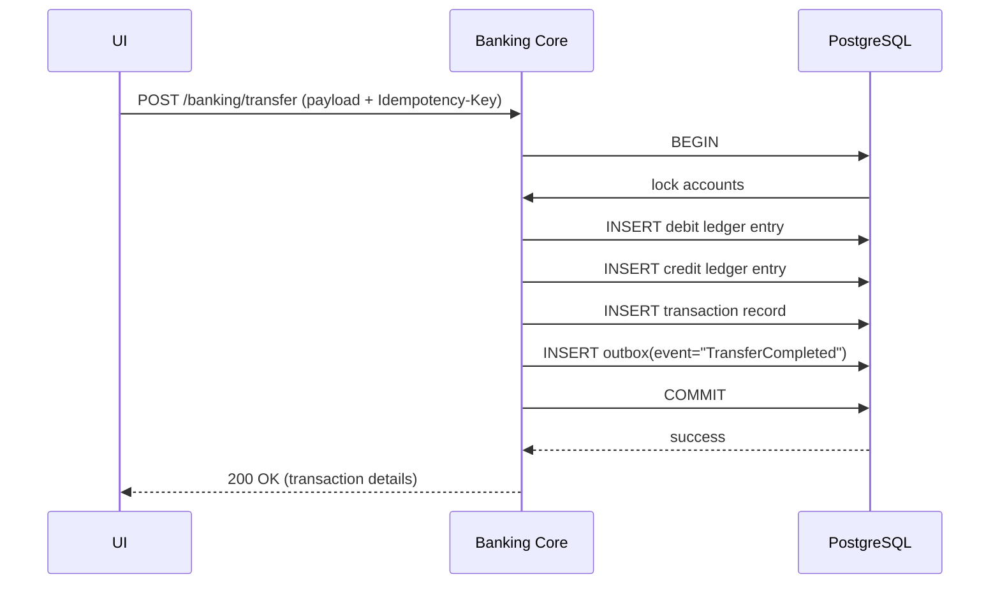
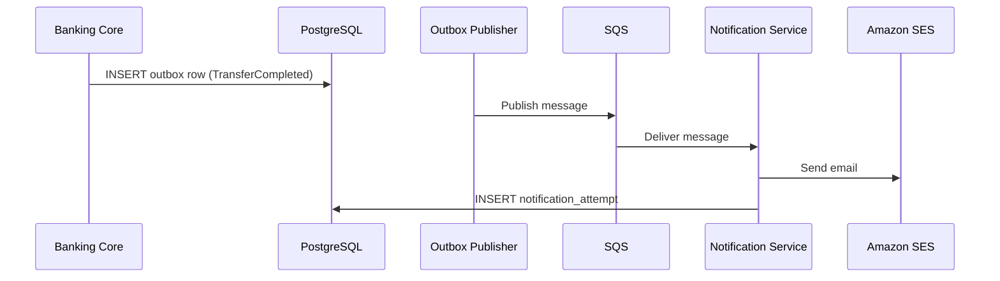
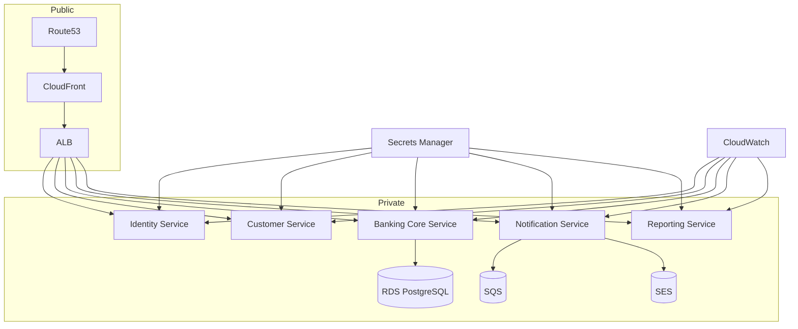

# Architecture Documentation for **Event‑Sourced Ledger (NexusBank)**

*Prepared by the Senior Software Architect – Phase 1*

---

## Table of Contents

1. [Current Architecture Overview](#current-architecture-overview)
2. [Functional Requirements (FR)](#functional-requirements-fr)
3. [Non‑Functional Requirements (NFR)](#non-functional-requirements-nfr)
4. [Proposed Target Micro‑services Architecture](#proposed-target-micro-services-architecture)
5. [Event‑Driven Transactional Outbox Pattern](#event-driven-transactional-outbox-pattern)
6. [AWS Deployment Architecture](#aws-deployment-architecture)
7. [Data Ownership Matrix](#data-ownership-matrix)
8. [Architectural Decision Records (ADR)](#architectural-decision-records-adr)
9. [Migration Roadmap](#migration-roadmap)
10. [Appendix – Mermaid Diagrams](#appendix---mermaid-diagrams)

---

## 1. Current Architecture Overview

The **existing codebase** is a **monolithic** application consisting of a **React + TypeScript** frontend, an **Express + TypeScript** backend, and a **PostgreSQL** database.  The backend follows a classic **domain‑module** structure with explicit routing, middleware, services, and repository layers.  Event sourcing and double‑entry accounting are implemented inside the same process.

### 1.1 High‑level diagram

```mermaid
flowchart TD
    subgraph Frontend[React Frontend]
        FE[UI Components & Pages]
        API[API Client (React‑Query)]
    end
    subgraph Backend[Express REST API]
        AuthM[Authentication Middleware]
        OwnershipM[Ownership Middleware]
        IdempotencyM[Idempotency Middleware]
        Router[main router]
        subgraph Modules[Domain Modules]
            Auth[Auth (register / login)]
            Cust[Customers]
            Acc[Bank‑Accounts]
            Banking[Banking (deposit, withdraw, transfer)]
            Tx[Transactions (detail, history)]
            Ledger[Ledger (event store)]
            Idemp[Idempotency Service]
        end
    end
    DB[(PostgreSQL)]

    FE -->|HTTP (Bearer JWT)| API -->|/auth, /customers, /accounts, /banking, /transactions| Router
    Router --> AuthM --> Auth
    Router --> OwnershipM --> Cust & Acc & Banking & Tx
    Router --> IdempotencyM --> Banking
    Modules --> DB
    Ledger --> DB
```

### 1.2 Backend structure (selected files)

| Layer | Path (relative to `backend/src`) | Purpose |
|------|-----------------------------------|---------|
| **Entry point** | `app.ts` / `server.ts` | Express app creation, middle‑wares, global error handling |
| **Routes** | `routes/index.ts` | Consolidates module routers (`/auth`, `/customers`, `/accounts`, `/banking`, `/transactions`) |
| **Auth module** | `modules/auth/*` | Registration, login, JWT creation/verification, password hashing (bcrypt) |
| **Customer module** | `modules/customers/*` | CRUD for `customers` table, repository pattern |
| **Bank‑account module** | `modules/bank-accounts/*` | Account creation, retrieval, ownership checks |
| **Banking module** | `modules/banking/*` | Deposit, withdraw, transfer handlers; idempotency middleware applied |
| **Transaction module** | `modules/transactions/*` | Transaction detail endpoint (`GET /transactions/:transactionId`) |
| **Ledger module** | `modules/ledger/*` | Event‑sourced ledger, double‑entry accounting, immutable ledger entries |
| **Idempotency module** | `modules/idempotency/*` | Stores idempotency keys; middleware ensures repeatable writes |
| **Middleware** | `middleware/*` | `authentication.ts` (JWT verification), `ownership.ts` (resource ownership), `idempotency.middleware.ts` |
| **Database** | `database/database.ts` | pg `Pool` wrapper, client helper |
| **Migrations** | `migrations/` | SQL files for schema creation (customers, users, accounts, ledger tables, idempotency, etc.) |
| **Tests** | `tests/` | Vitest unit & integration tests (backend only) |

### 1.3 Frontend structure (selected files)

| Layer | Path (relative to `frontend/src`) | Purpose |
|------|-----------------------------------|---------|
| **Root** | `main.tsx`, `App.tsx` | React entry, routing, global providers |
| **Routing** | `features/router.tsx` (or similar) | React‑Router v6 configuration, protected routes using `AuthContext` |
| **Context** | `context/auth.tsx` | Stores JWT in memory, provides `login`, `logout`, `register` helpers |
| **API client** | `lib/api-client.ts` | Thin wrapper around `fetch` + `react‑query` hooks, adds `Authorization` header, centralises error handling |
| **Pages** | `features/*` (e.g., `login`, `dashboard`, `deposit`, `transfer`, `transaction-history`, `transaction-details`) | UI components built with Tailwind CSS, reusable shared UI (`components/shared/*`) |
| **React‑Query** | Queries defined per‑feature (`useDeposit`, `useAccountBalance`, `useTransactionHistory`…) | Caching, automatic refetch, cache invalidation after mutations |
| **Tests** | `test/**/*.test.tsx` | Vitest UI/component tests (currently not discovered due to config – see Section 2) |

### 1.4 Authentication & Authorization Flow

1. **Registration** – `POST /auth/register` → creates a `customer` row, inserts a corresponding `users` row with bcrypt password hash, returns a JWT.
2. **Login** – `POST /auth/login` → validates credentials, returns a JWT.
3. **JWT Verification** – `middleware/authentication.ts` extracts `Bearer` token, verifies using `jwt.verify` with secret `env.JWT_SECRET`, populates `req.auth.customerId`.
4. **Ownership Checks** – `middleware/ownership.ts` ensures the `customerId` from JWT matches the resource owner (account, transaction) before the handler runs.
5. **Protected Routes** – All routes except `/auth/*` are mounted *after* `authenticate` middleware.

### 1.5 Event‑Sourcing & Double‑Entry Accounting

* The **ledger** module records each financial action as an immutable event (`ledger_events` table).  A **debit** and a **credit** entry are written atomically inside the same DB transaction, guaranteeing double‑entry consistency.
* Account balances are derived by aggregating ledger entries; no mutable “balance” column is stored.
* Idempotency keys (`idempotency_keys` table) guarantee that repeated write requests with the same key do not create duplicate ledger events.

### 1.6 Testing & Tooling

* **Backend** – `npm run test` executes Vitest suites in `backend/tests`.  Tests cover auth, idempotency, banking operations, and ledger invariants.
* **Frontend** – Test files exist under `frontend/src/test/**/*.test.tsx` but the current `vitest.config.ts` does not include the `frontend` folder, leading to “No test files found”.  (Documented as a gap.)
* **Type‑checking** – `npm run typecheck` uses `tsc --noEmit` and passes for both backend and frontend.
* **Build** – `npm run build` produces a Vite optimized bundle.
* **Docker** – No Docker Compose files are present; the project relies on a locally running PostgreSQL instance.  Future deployment will containerise the services (see Section 4).

---

## 2. Functional Requirements (FR)

| ID | Description | Status (implemented?) |
|----|-------------|-----------------------|
| **FR‑01** | Users can register using name, email, phone, password. | ✅ Implemented (`/auth/register`). |
| **FR‑02** | Users can log in using registered credentials. | ✅ Implemented (`/auth/login`). |
| **FR‑03** | Passwords must be securely hashed; plain‑text never stored. | ✅ Implemented (bcrypt, `BCRYPT_COST = 12`). |
| **FR‑04** | Protected APIs require valid authentication. | ✅ Implemented (global `authenticate` middleware). |
| **FR‑05** | Users must only access their own customer and banking information. | ✅ Implemented (ownership middleware). |
| **FR‑06** | Users must be able to log out. | ⚪️ *Not currently implemented* – client simply discards JWT; no server‑side revocation. |
| **FR‑07** | Password‑reset via email. | ⚪️ *Missing* – no email service or reset endpoint. |
| **FR‑08** | Email address verification. | ⚪️ *Missing*. |
| **FR‑09** | Multi‑factor authentication (MFA). | ⚪️ *Missing*. |
| **FR‑10** | Login‑history & suspicious‑login notifications. | ⚪️ *Missing*. |
| **FR‑11** | Users can view personal profile. | ✅ Implemented (GET `/customers/me`). |
| **FR‑12** | Users can update permitted profile information. | ✅ Partial – update endpoint exists, but limited fields. |
| **FR‑13** | Users can view registered contact information. | ✅ Implemented via profile endpoint. |
| **FR‑14** | Manage notification preferences. | ⚪️ *Missing*. |
| **FR‑15** | Sensitive customer info restricted to authorized users. | ✅ Enforced by ownership middleware. |
| **FR‑16** | Users can create eligible bank accounts. | ✅ Implemented (POST `/accounts`). |
| **FR‑17** | Users can view all their accounts. | ✅ Implemented (GET `/accounts`). |
| **FR‑18** | Users can view individual account details. | ✅ Implemented (GET `/accounts/:accountNumber`). |
| **FR‑19** | Account type and status visible. | ✅ Implemented (fields returned). |
| **FR‑20** | View available & current balances. | ✅ Implemented (GET `/banking/:accountNumber/balance`). |
| **FR‑21** | Multiple accounts per user supported. | ✅ Supported by schema (`accounts.customer_id`). |
| **FR‑22** | Account status changes follow authorization rules. | ✅ Enforced via ownership middleware; status change endpoints exist. |
| **FR‑23** | Deposit money into accounts. | ✅ Implemented (POST `/banking/deposit`). |
| **FR‑24** | Withdraw money from accounts. | ✅ Implemented (POST `/banking/withdraw`). |
| **FR‑25** | Transfer money between eligible accounts. | ✅ Implemented (POST `/banking/transfer`). |
| **FR‑26** | Prevent transfers when insufficient funds. | ✅ Enforced in `transferHandler` (balance check). |
| **FR‑27** | Every financial operation generates an auditable transaction record. | ✅ Implemented via ledger events. |
| **FR‑28** | Double‑entry accounting consistency. | ✅ Implemented in ledger module. |
| **FR‑29** | Failed operations must not leave partially committed records. | ✅ Guaranteed by DB transaction (`BEGIN … COMMIT/ROLLBACK`). |
| **FR‑30** | Write operations support idempotency. | ✅ Implemented (idempotency middleware + key table). |
| **FR‑31** | Protect against concurrent operations that could produce incorrect balances. | ✅ Concurrency handled by DB row‑level locks in banking handlers. |
| **FR‑32** | Users must be able to view transaction status. | ✅ Partial – transaction detail endpoint returns status. |
| **FR‑33‑FR‑37** | Beneficiary management (add / view / edit / confirm / notifications). | ⚪️ *Missing* – no beneficiary module. |
| **FR‑38‑FR‑43** | Scheduled / recurring payments, validation, failure handling. | ⚪️ *Missing* – no scheduler / jobs. |
| **FR‑44‑FR‑50** | Transaction history, filtering, search, details, statements, PDF export. | ✅ History (`GET /banking/:accountNumber/history`) and detail (`GET /transactions/:transactionId`) exist; filtering & PDF export not present. |
| **FR‑51‑FR‑67** | Dashboard‑level aggregates (total balance, recent transactions, summaries, navigation). | ✅ Basic dashboard exists; advanced summaries not yet implemented. |
| **FR‑68‑FR‑72** | Administration & audit (admin view, block accounts, audit logs). | ⚪️ *Missing* – no admin role / audit table. |

> **Legend**: ✅ Implemented, ⚪️ Missing / not yet implemented, ⏳ Partial / limited implementation.

---

## 3. Non‑Functional Requirements (NFR)

| ID | Requirement | Current Implementation | Remarks |
|----|-------------|------------------------|--------|
| **NFR‑01** | All production communication over HTTPS/TLS. | ⚪️ Not applicable in local dev; no TLS termination in code. | Will be handled by ALB/CloudFront in AWS deployment. |
| **NFR‑02** | Secure password hashing. | ✅ bcrypt with cost 12. |
| **NFR‑03** | Enforced authentication & authorization on backend. | ✅ Middleware chain (`authenticate`, `ownership`). |
| **NFR‑04** | Users never access another customer's data. | ✅ Enforced by ownership checks. |
| **NFR‑05** | Secrets never committed to repo. | ✅ `.env.example` used; real secrets in `.env` (git‑ignored). |
| **NFR‑06** | Production secrets via AWS Secrets Manager. | ⚪️ Not yet integrated – future target. |
| **NFR‑07** | Validate all incoming requests. | ✅ Zod schemas used in each controller (`*.schema.ts`). |
| **NFR‑08** | Protect against SQL‑injection, XSS, CSRF, etc. | ✅ Parameterised queries prevent SQL‑i; CSRF not needed for JWT‑based API; XSS mitigated by React. |
| **NFR‑09** | Rate limiting on sensitive endpoints. | ⚪️ Not present – would be added via middleware (e.g., `express-rate-limit`). |
| **NFR‑10** | Financial records immutable. | ✅ Ledger entries are never updated; only inserts. |
| **NFR‑11** | Sensitive info not logged. | ✅ Logging (via `console`) is minimal; no password logs. |
| **NFR‑12** | Financial ops preserve ACID. | ✅ Single PostgreSQL transaction per operation. |
| **NFR‑13** | Double‑entry entries remain balanced. | ✅ Ledger module enforces credit = debit per transaction. |
| **NFR‑14** | Idempotent writes. | ✅ Idempotency middleware + key store. |
| **NFR‑15** | Safe rollback on failure. | ✅ `ROLLBACK` on catch blocks. |
| **NFR‑16** | Notification failures must not affect transactions. | ⚪️ Not yet applicable – no notification service. |
| **NFR‑17** | Async consumers support retries & duplicate delivery. | ⚪️ Future (outbox + SQS). |
| **NFR‑18** | Critical data backup. | ⚪️ Not in scope of current repo. |
| **NFR‑19** | Service‑failure recovery. | ⚪️ Basic Node process restart; no clustering. |
| **NFR‑20‑NFR‑24** | Performance, pagination, indexing, scaling. | ✅ Basic indexes exist (primary keys, foreign keys); pagination implemented for history; performance not benchmarked. |
| **NFR‑25‑NFR‑29** | Service independence, data separation, maintainability. | ✅ Current monolith respects separation of concerns via modules; future micro‑service split will enforce stricter boundaries. |
| **NFR‑30‑NFR‑34** | Observability, health checks, monitoring, CI/CD. | ⚪️ Minimal – only console logs; health endpoint (`/health`) exists in `health` module. |
| **NFR‑35‑NFR‑50** | AWS‑centric deployment considerations. | ⚪️ Planned for future phases. |

---

## 4. Proposed Target Micro‑services Architecture

The goal is **gradual extraction** of logical boundaries while keeping the current monolith functional.

### 4.1 Service Catalogue
| Service | Responsibility | Future Data Ownership |
|--------|----------------|-----------------------|
| **Identity Service** | Registration, login, password hashing, JWT issuance, optional MFA, credential storage. | `users`, `auth_tokens`, `mfa_secrets` |
| **Customer Service** | Profile CRUD, notification preferences, contact information. | `customers`, `notification_preferences` |
| **Banking Core Service** | Account creation, balance queries, deposit/withdraw/transfer, ledger event store, idempotency keys. | `accounts`, `ledger_events`, `idempotency_keys` |
| **Notification Service** | Asynchronous email/SMS delivery, event consumption, delivery tracking. | `notifications`, `notification_attempts` |
| **Reporting Service** | Read‑only projections (statement generation, historical balance queries, analytics). | `report_views` (materialised tables) |

### 4.2 Interaction Model
* **Synchronous API** – UI → **Identity**, **Customer**, **Banking Core** (REST/JSON over HTTPS).
* **Asynchronous Events** – `Banking Core` writes an **outbox** record → **Notification Service** consumes via **SQS** → sends email via **SES**.
* **Reporting Service** reads from **read‑only replicas** or materialised views populated by event listeners.

### 4.3 Migration Strategy (high level)
1. **Introduce Service Interfaces** – keep the monolith but expose internal modules via HTTP adapters.
2. **Extract Identity Service** – move auth logic into its own Express app, keep DB shared initially.
3. **Add Outbox Table** – modify `banking` transaction flow to write events to `outbox`.
4. **Deploy Notification Service** – simple worker that polls SQS and sends emails.
5. **Gradually split Customer & Banking Core** – once APIs are stable, point UI to new service URLs.
6. **Eventually migrate each service to its own schema or database** – preserve logical ownership.

---

## 5. Event‑Driven Transactional Outbox Pattern

### 5.1 Flow Diagram (transfer)


### 5.2 Guarantees
* **Atomicity** – all ledger writes and the outbox row are in a single DB transaction; either all succeed or none.
* **At‑least‑once delivery** – SQS guarantees that a message will be delivered at least once.
* **Idempotent consumer** – Notification Service stores the `eventId` and skips duplicate processing.
* **Retry & DLQ** – SQS redrive policy moves failed messages to a Dead‑Letter Queue after N attempts; the consumer can log and alert.
* **Event versioning** – `outbox` includes `event_type` and `schema_version` to allow future schema evolution.
* **Eventual consistency** – UI may show the transaction as completed before the email arrives; the notification is decoupled.

---

## 6. AWS Deployment Architecture

```mermaid
graph LR
    subgraph Client[Client]
        B[Browser / Mobile]
    end
    subgraph Edge[Edge]
        CF[CloudFront]
        R53[Route53]
    end
    subgraph AWS[VPC]
        subgraph Public
            ALB[Application Load Balancer]
        end
        subgraph Private
            ID[Identity Service]
            CS[Customer Service]
            BC[Banking Core Service]
            NS[Notification Service]
            RS[Reporting Service]
            RDS[(Amazon RDS PostgreSQL)]
            SQS[(Amazon SQS)]
            DLQ[(Dead‑Letter Queue)]
        end
    end
    subgraph Infra[Support]
        SM[Secrets Manager]
        CW[CloudWatch Logs & Metrics]
        ECR[ECR Container Registry]
    
    end

    B -->|HTTPS| CF -->|CNAME| R53 --> ALB --> ID
    ALB --> CS
    ALB --> BC
    ALB --> RS
    ALB --> RS
    BC --> RDS
    ID --> RDS
    CS --> RDS
    NS --> SQS
    SQS --> NS
    SQS -->|DL| DLQ
    NS --> ECR
    BC --> SQS   %% outbox publishing
    RS --> RDS   %% notification attempts
    SM --> ID & CS & BC & NS & RS
    CW --> ID & CS & BC & NS & RS
```

### Component responsibilities
* **Route53** – DNS for `api.nexusbank.example.com` and `cdn.nexusbank.example.com`.
* **CloudFront** – CDN for static frontend assets (S3 bucket) and optional edge caching of API responses.
* **ALB** – TLS termination, request routing to ECS services.
* **ECS Fargate** – Containerised services (Identity, Customer, Banking Core, Notification, Reporting).
* **RDS PostgreSQL** – Single database instance initially; schemas may be separated per service later.
* **SQS** – Event bus for outbox events; DLQ for failed notifications.
* **SES** – Email delivery (transactional emails).
* **Secrets Manager** – Stores `JWT_SECRET`, DB credentials, SES API keys.
* **CloudWatch** – Structured logs, metrics, health‑check alarms.

---

## 7. Data Ownership Matrix

| Service | Owned Tables / Schemas | Access Pattern |
|---------|------------------------|----------------|
| **Identity** | `users`, `auth_tokens`, `mfa_secrets` | Direct read/write; **no** access to other tables.
| **Customer** | `customers`, `notification_preferences` | Reads own profile; writes limited fields.
| **Banking Core** | `accounts`, `ledger_events`, `idempotency_keys`, `outbox` | Full CRUD for financial data; reads customer IDs via foreign keys.
| **Notification** | `notifications`, `notification_attempts` | Reads `outbox` events; writes delivery logs.
| **Reporting** | `report_views` (materialised), read‑only access to ledger & accounts | Reads only; no writes.

*Future*: each service will be granted **principle‑of‑least‑privilege** IAM DB roles when split into separate containers.

---

## 8. Architectural Decision Records (ADR)

| # | Decision | Reasoning |
|---|----------|-----------|
| **ADR‑001** | **Retain the existing event‑sourced ledger in the monolith** | Ledger provides the single source of truth for balances; moving it would require distributed transactions. Keeping it intact avoids data‑consistency risk during early migration. |
| **ADR‑002** | **Do not split every module into its own micro‑service immediately** | Premature decomposition adds operational overhead, increases latency, and complicates data consistency. A staged approach lets us validate boundaries before extraction. |
| **ADR‑003** | **Keep Accounts and Ledger together in Banking Core** | Both modules share the same transactional scope; separating them would require a saga‑style coordination for every write. |
| **ADR‑004** | **Adopt Transactional Outbox + SQS for asynchronous notifications** | Guarantees atomic write‑and‑publish without a distributed transaction manager; SQS is managed, cost‑effective, and integrates well with AWS ecosystem. |
| **ADR‑005** | **Choose Amazon SQS over Kafka for the first production release** | SQS is server‑less, requires no cluster management, and provides at‑least‑once delivery with DLQ support – sufficient for email notifications. |
| **ADR‑006** | **Deploy services on AWS ECS Fargate rather than EKS** | Fargate abstracts the underlying EC2 infrastructure, reducing ops burden; Kubernetes adds complexity that is unnecessary for the current scale. |
| **ADR‑07** | **Use PostgreSQL (Amazon RDS) as the persistent store** | Already used locally; RDS offers automated backups, scaling, and IAM authentication, aligning with existing schema and queries. |
| **ADR‑08** | **Send email via Amazon SES** | Reliable, low‑cost transactional email service; integrates with IAM for secure credential handling. |
| **ADR‑09** | **Separate database ownership by schema rather than separate databases initially** | Minimises data migration effort while still enforcing logical boundaries; later services can be moved to distinct DB instances if needed. |
| **ADR‑10** | **Introduce rate‑limiting middleware in a later phase** | Not critical for current internal demo; will be added once the API is publicly exposed. |

---

## 9. Migration Roadmap

| Phase | Objective | Scope | Dependencies | Acceptance Criteria |
|------|-----------|-------|--------------|---------------------|
| **1** | Architecture & requirements documentation | Produce `architecture.md` (this document). | None | Document approved by stakeholders. |
| **2** | Stabilise existing stack | Verify backend tests pass, Vite dev server runs, frontend functional flows work. | PostgreSQL running, environment variables correct. | All backend tests PASS; UI can register, login, perform a deposit/withdraw/transfer; no console errors. |
| **3** | Extract **Identity Service** | Move auth routes, JWT generation, password hashing into a separate Express app; expose `/auth/*` endpoints. | Phase 2 stable, shared DB accessible. | Identity Service deployed independently; existing UI points to new URL; auth flow unchanged. |
| **4** | Extract **Customer Service** | Migrate customer profile CRUD to its own service; keep ownership checks.
| **5** | Extract **Banking Core Service** | Move account, banking, ledger, idempotency logic into a new service; introduce outbox table. |
| **6** | Implement **Transactional Outbox** & **SQS** | Add `outbox` table, publisher job, SQS queue configuration. |
| **7** | Deploy **Notification Service** | Consume outbox events, send emails via SES, record attempts. |
| **8** | Add **Reporting Service** | Materialised views for statements, historical balance queries. |
| **9** | Frontend refactor for micro‑service APIs | Update API client base URLs, handle service discovery via environment.
| **10** | Containerisation & CI/CD | Dockerfiles for each service, GitHub Actions pipeline, image push to ECR. |
| **11** | Deploy to **AWS ECS Fargate** | Create task definitions, ALB routing, secret injection via Secrets Manager. |
| **12** | Observability, security hardening, performance testing | CloudWatch alarms, rate limiting, load‑test scripts, penetration test checklist. |

> **Note**: Each phase builds on the previous one; no phase will modify existing core banking logic without a passing test suite.

---

## 10. Appendix – Mermaid Diagrams

### 10.1 Current Monolithic Architecture (re‑iterated)


### 10.2 Target Micro‑services Architecture (high‑level)


### 10.3 Money Transfer Sequence (within Banking Core)


### 10.4 Asynchronous Email Notification Flow


### 10.5 AWS Deployment Architecture (detailed)


---

*End of `architecture.md`.*
